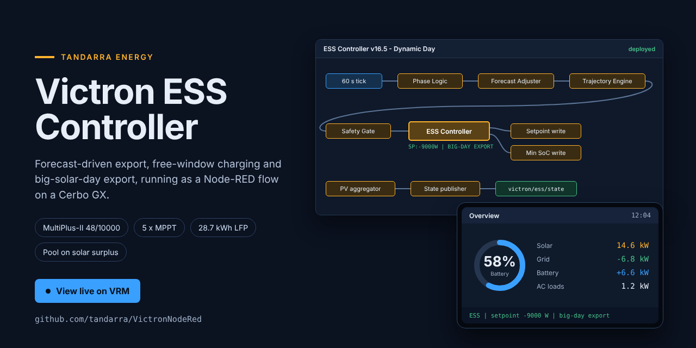
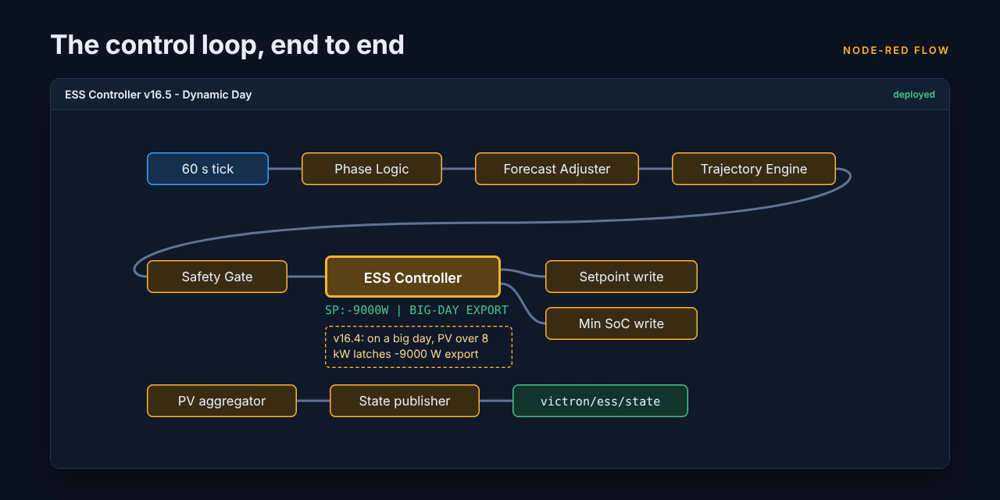
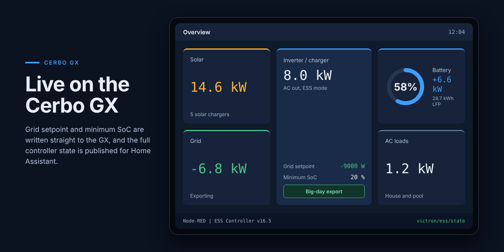

# VictronNodeRed

Node-RED ESS controller for the Tandarra Victron system at Pokeno, NZ, with the Home Assistant pool automation that follows it.

**[View the installation live on VRM](https://vrm.victronenergy.com/installation/515169/share/20610da3)** (read-only share link)

| | |
|---|---|
| Inverter / charger | MultiPlus-II 48/10000 (about 8 kW AC) |
| Solar | 19.44 kW across 3 arrays, 5 MPPTs (can charge a battery at more than 14 kW) |
| Battery | 28.7 kWh LFP |
| Controller | Cerbo GX running this Node-RED flow |
| Home Assistant | pool control, dashboards, energy costs |

## What the flow does

A 60 s tick runs: phase logic, forecast adjuster (Open-Meteo, per-array model), trajectory engine, safety gate, then the **ESS Controller** writes the grid setpoint and minimum SoC to the Cerbo and the **State publisher** sends the full state to MQTT (`victron/ess/state`).

- **Forecast-driven export and overnight charging** on cheap/free power.
- **Big solar day export (v16.4):** the first time PV passes 8 kW on a big forecast day the day is latched and the setpoint goes to -9000 W, so the battery empties into the grid while the MPPTs run flat out. Stops below 40 % SoC (resumes at 43 %), at sunset minus 3 h (16:30 fallback), or if PV stays under 3 kW for 45 min (bust day). Never overrides FAULT, free charge, stale SoC or the pre-08:00 clamp.
- **Daily energy counters** (grid import/export, AC load) survive a redeploy (v16.5).

## Pool control (Home Assistant)
See [`homeassistant/`](homeassistant/README.md): solar heating with a PV-surplus bypass so the pool starts at 10:00 on big days, a late run to 18:00+, and a load shed that stops the pump when AC loads go above 8 kW.

## Install
Node-RED: Menu > Import > select `flows.json` (replace the existing tab) > Deploy.

## Versions
See [`CHANGELOG.md`](CHANGELOG.md).

| Version | Change |
|---|---|
| v16.5 | Redeploy no longer wipes the daily energy counters |
| v16.4 | Big-solar-day export latch (-9000 W) |
| v16.3 | PV surplus export (superseded by v16.4) |
| v16.1 | Baseline |

## Rollback
Every update is one commit and one tag. To get an older flow:

    git log --oneline -- flows.json
    git show <commit-or-tag>:flows.json > flows-old.json

Then import `flows-old.json` into Node-RED.
